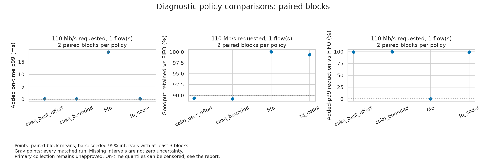
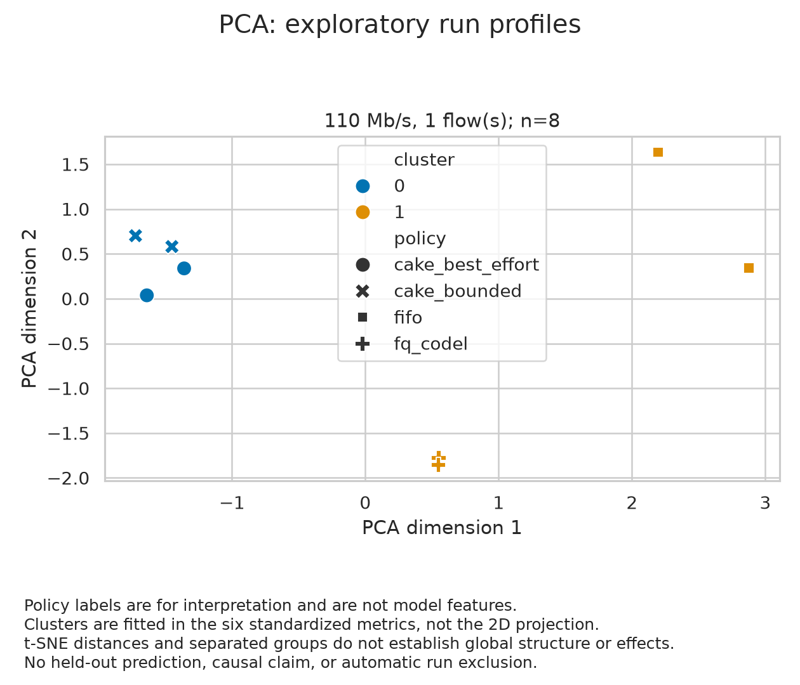
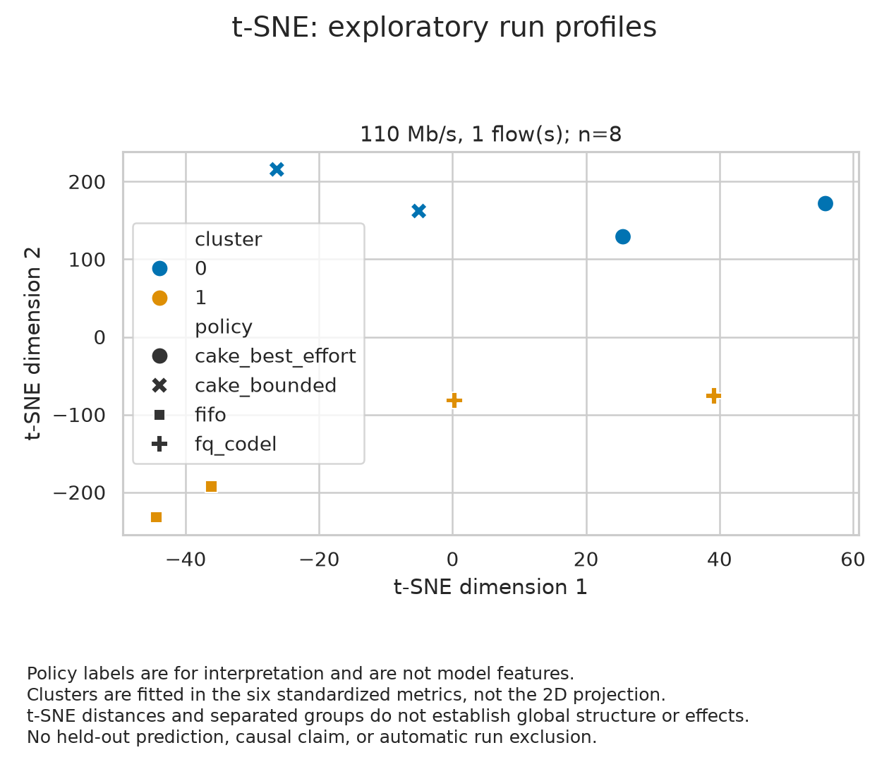

# Protecting tail latency under contention

CS 585 Computer Networks, University of New Mexico, Fall 2026.

We compare FIFO, FQ-CoDel, CAKE best-effort, and CAKE with bounded classification
when short request-response messages share a bottleneck with bulk TCP traffic.
The question is how much foreground delay each policy can avoid while retaining
bulk goodput.

[Run the pipeline](#run-the-analysis-on-macos-or-linux) |
[NucBox collection](#collect-on-the-nucbox) |
[Docker and YAML](#run-analysis-with-docker-compose) |
[Pipeline UML](#pipeline-uml-sequence-diagram) |
[Analysis definitions](analysis/README.md) |
[Remaining work](docs/project-completion.md)

## Diagnostic results

This preview comes from [Linux workflow 43111991762](https://github.com/srgangaram-swe/networks_project/actions/runs/43111991762),
source e3ddaff. It contains 16 randomized namespace trials and 80,000 measured
request slots. Of those slots, 3,192 were unsent (3.99%); there were no timeout
or late outcomes. Every policy has two paired blocks, so confidence intervals
are unavailable. These are virtual testbed diagnostics, not primary results
or measurements of the NucBox's Ethernet adapters.

| Policy | Mean added on-time p99 | TCP goodput retained vs FIFO |
|---|---:|---:|
| FIFO | 18.977 ms | 100.00% |
| FQ-CoDel | 0.104 ms | 99.37% |
| CAKE best-effort | 0.106 ms | 89.37% |
| CAKE bounded | 0.094 ms | 89.18% |

The proposed targets are a 50% reduction in added p99 and at least 90% of FIFO's
bulk goodput. Both CAKE variants fell below the goodput target in this pilot.
Unsent requests and the small number of blocks still need investigation.

### Exploratory run profiles

K-means fits six standardized run metrics within each load/flow condition.
PCA and t-SNE show those same metrics in two dimensions. Policy names are only
plot labels, and separated groups do not establish causality or predictive accuracy.
Click either image to inspect the full figure.

| PCA | t-SNE |
|---|---|
|  |  |

Browse the [comparison CSV](data/reference/namespace-pilot-2026-11-11/analysis/policy_comparisons.csv),
[per-run statistics](data/reference/namespace-pilot-2026-11-11/analysis/run_statistics.csv),
[readable summary](data/reference/namespace-pilot-2026-11-11/analysis/diagnostic_summary.txt),
and [full provenance and model settings](data/reference/namespace-pilot-2026-11-11/analysis/report.json).
The [reference directory](data/reference/namespace-pilot-2026-11-11/README.md)
contains the exact export needed to rebuild these results.

## Run the analysis on macOS or Linux

Prerequisites: Git and Python 3.12 or newer. Run the following from a terminal:

    git clone https://github.com/srgangaram-swe/networks_project.git
    cd networks_project
    git switch dev
    sh scripts/setup_environment.sh --plan
    sh scripts/setup_environment.sh
    mkdir -p runs
    .venv/bin/python -m analysis.policy_comparison \
      data/reference/namespace-pilot-2026-11-11/export \
      --output runs/reference-analysis-01

The shell script creates .venv, installs the pinned development and analysis
packages, and checks dependency consistency. It can reuse a valid environment
without deleting it. An existing directory must identify itself as an isolated
Python environment before packages are installed. The script does not install
OS packages or change the system interpreter.

If Python 3.12+ is installed under a different command, select it explicitly:

    PYTHON=python3.12 sh scripts/setup_environment.sh

Use the actual supported interpreter on your machine. The launcher tries an
existing .venv, then python3.12, then python3. If the selected Python is too old,
it stops with a message before creating an environment. The [Python downloads](https://www.python.org/downloads/)
page has installers. A custom location or smaller analysis-only profile is optional:

    mkdir -p .local
    sh scripts/setup_environment.sh --venv .local/analysis-env --profile analysis

The analysis accepts ordinary CSV exports or the checked compressed request CSV
in the reference example. For your own data, replace the input path with the
export produced by the experiment runner. The output directory must be new;
choose a new name for each rebuild. Input data is never overwritten.

### What the output contains

| File | Use |
|---|---|
| runs.csv and run_statistics.csv | Per-run metrics and grouped descriptive statistics |
| matched_baselines.csv | Same-policy, same-block unloaded baseline for each loaded run |
| policy_comparisons.csv | Added latency, relative effects, goodput retention, interval status, and point targets |
| run_clusters.csv | Cluster assignments and PCA/t-SNE coordinates |
| policy_comparisons.png | Policy means, all matched runs, and available uncertainty |
| run_clusters.png and run_clusters_tsne.png | Exploratory PCA and t-SNE panels |
| report.json | Input/output hashes, source identities, settings, counts, and limitations |
| diagnostic_summary.txt and writeup_table.tex | Readable results and a LaTeX table for drafting the report |

A completed report still has primary eligibility set to false. Read interval
and comparison status fields before interpreting a percentage. See the
[analysis guide](analysis/README.md) for definitions, pairing, bootstrap rules,
censoring, and ML limits.

## Collect on the NucBox

First set up Ubuntu 24.04 LTS, Python 3.12+, and local access or SSH using the
[NucBox guide](docs/nucbox-setup.md). The Mac is the development/control machine;
collection runs on the isolated Linux host. This backend uses client, router,
and server namespaces on that one host. It does not configure physical NICs.

From the project checkout on the NucBox, run the installer as your ordinary
Linux account:

    sh scripts/setup_nucbox.sh --plan
    sh scripts/setup_nucbox.sh --install
    .venv/bin/python scripts/nucbox_experiment.py plan
    mkdir -p runs
    sudo .venv/bin/python scripts/nucbox_experiment.py run \
      --output runs/nucbox-pilot-01 --authorized-isolated-host

The installer prepares OS tools, the shared Python environment, and component
checks. The run command inspects hardware, checks all four policies, executes
the recorded 16-trial pilot, exports validated observations, and runs the full
analysis. Expect roughly ten minutes, depending on the host.

The result has hardware.json, setup/, campaign/, export/, analysis/, and
status.json. Root owns this output; use sudo to inspect it. The last stage and
any completed observations remain after a failure. Do not repeat a command into
an existing output directory. The guide covers exact-resource cleanup, explicit
replacement reasons, and recovery without losing earlier attempts.

The larger diagnostic matrix is an explicit choice:

    .venv/bin/python scripts/nucbox_experiment.py plan --diagnostic-matrix
    sudo .venv/bin/python scripts/nucbox_experiment.py run --diagnostic-matrix \
      --output runs/nucbox-matrix-01 --authorized-isolated-host

That plans 280 cells: 40 unloaded and 240 loaded runs, ten paired blocks, and
60 measured seconds per run. Allow more than 5.5 hours plus setup and analysis.
The exporter makes 47 bounded batches, and analysis accepts the export root
directly. All observations remain diagnostic. Actual device checks, calibration,
exact foreground/bulk window alignment, and accepted protocol choices are still
needed before primary collection. See the [completion checklist](docs/project-completion.md).

## Run analysis with Docker Compose

Docker with the Compose plugin is optional. The [compose.yaml](compose.yaml)
service builds [Dockerfile](Dockerfile), creates its own Python environment,
and runs the same analysis command. A Git checkout is required so the report
can record the source identity. Run from the repository root:

    mkdir -p runs/container-output-01
    export LOCAL_UID="$(id -u)" LOCAL_GID="$(id -g)"
    export INPUT_DIR="$PWD/data/reference/namespace-pilot-2026-11-11/export"
    export OUTPUT_DIR="$PWD/runs/container-output-01"
    docker compose config --quiet
    docker compose run --build --rm analysis

The result appears in runs/container-output-01/analysis on the host. Use an
existing input directory and an existing writable output parent. Neither mount
is created silently. For a later rebuild, choose a fresh output parent or override
the destination explicitly:

    docker compose run --rm analysis /inputs/export --output /outputs/analysis-02

The container runs as your supplied user/group, with a read-only root filesystem,
read-only source and input mounts, dropped capabilities, and no runtime network.
Only the selected output directory and temporary cache are writable. Building
the image downloads packages. It uses a digest-pinned Python base and the same
analysis locks as the native setup. CI builds this image and compares its rebuilt
point estimates and output integrity with the published diagnostic example.

The container supports offline analysis. Use native Linux for privileged
namespace collection and kernel/qdisc checks. See [container details](docs/containers.md)
for mounts, permissions, source provenance, and troubleshooting.

## Pipeline UML sequence diagram

The diagram follows the collection driver, retained attempts, cleanup, export,
and analysis. [The editable Mermaid source](docs/pipeline.mmd) is kept alongside
the operating documentation.

~~~mermaid
sequenceDiagram
    actor User
    participant Pipeline
    participant Campaign
    participant Trial
    participant Analysis as Export and analysis
    participant Files as Artifacts
    User->>Pipeline: Run a recorded diagnostic plan
    Pipeline->>Pipeline: Inspect host and check four policies
    Pipeline->>Campaign: Save source, configuration, seed and schedule
    loop Each unfinished scheduled cell
        Campaign->>Trial: Run in fresh owned namespaces
        Trial->>Trial: Warmup, measure, drain and clean up
        Trial->>Files: Observations, counters and manifest
        Trial-->>Campaign: Validated bundle or failure
        Campaign->>Files: Retain attempt and manifest hash
    end
    Campaign-->>Pipeline: Completed schedule or stopped state
    alt Collection completed
        Pipeline->>Analysis: Export observations and full attempt ledger
        Analysis->>Analysis: Check hashes, counts and recorded pairings
        Analysis->>Analysis: Paired bootstrap, K-means, PCA and t-SNE
        Analysis->>Files: CSV tables, plots, summary and LaTeX table
        Pipeline-->>User: Completed diagnostic results
    else Failure or cancellation
        Pipeline->>Files: Keep failed stage and partial evidence
        Pipeline-->>User: Inspect and resume with an explicit reason
    end
    Note over Pipeline,Files: No overwritten runs or automatic retries. Primary eligibility remains false.
~~~

## Checks and project scope

    sh scripts/check.sh
    sh scripts/check_analysis.sh

Install iperf3 before the TCP integration tests; the NucBox installer does this.
The core and analysis suites each require at least 90% branch coverage. The
workflow also checks C++ builds, sanitizers, real sockets, and the Docker rebuild.
Privileged Linux checks are a separate explicit workflow input; a skipped
hardware test is not a passed experiment.

The [experiment protocol](docs/experiment-protocol.md) describes the planned
100 Mb/s bottleneck, 20 ms base RTT, 512-byte foreground messages at 500 requests/s,
three background demand targets, and one or eight TCP flows. The
[measurement contract](docs/decisions/0001-measurement-contract.md) remains a
candidate for team review. [Open issues](https://github.com/srgangaram-swe/networks_project/issues)
and the [completion checklist](docs/project-completion.md) track the remaining
scientific and course deliverables.

Dev is the integration and default landing branch. Work branches merge into dev;
validated milestone candidates progress from dev to prod to main. Follow
[CONTRIBUTING.md](CONTRIBUTING.md) and preserve teammates' original histories.

## Team

Saif Ryan Gangaram, Christopher Ong, Alejandro Magana Guillen, and Jonathan Lloyd.
Jonathan's policy-comparison workflow and Chris's C++ prototype are retained in
the combined pipeline. The [C++ guide](experiments/cpp_network_testing/README.md)
explains its separate loopback TCP measurement.

This is a course project using synthetic traffic on equipment we control.
It contains no employer data and implies no employer endorsement.
