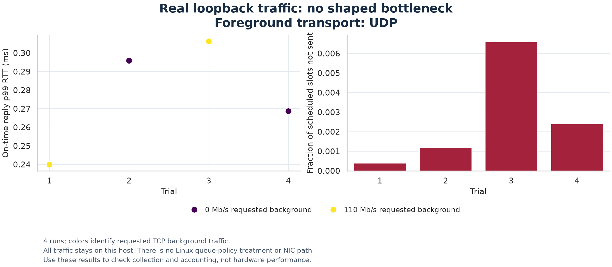
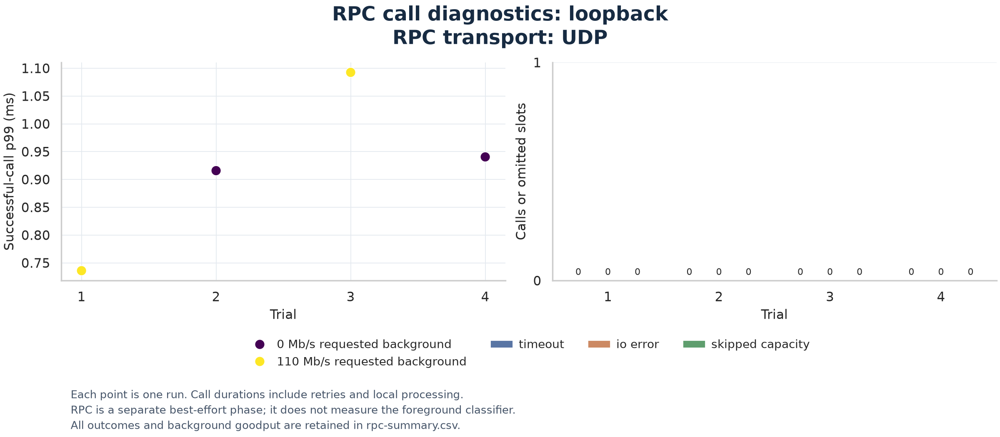

# Real Mac loopback and RPC measurements

We collected four trials on November 26 with clean source e0d8dc8. Traffic
stayed on 127.0.0.1. Two randomized blocks each contain an unloaded trial and
a trial requesting 110 Mb/s of TCP background traffic. Each foreground phase
lasts ten seconds after two seconds of warmup. Each separate RPC phase
schedules 5,000 calls.

The foreground phase retained 20,000 slots: 19,947 on-time replies, 53 unsent
slots and no timeout or late outcomes. All 20,000 RPC calls completed without
retries, I/O errors or worker-capacity omissions. Foreground p99 ranged from
0.240 to 0.306 ms. Successful RPC call p99 ranged from 0.736 to 1.093 ms and
includes local call processing. Those durations have different boundaries.

The maximum RPC start lag reached 12.855 ms. Completion is therefore not proof
of perfect pacing. Loopback also omits the physical links, adapters and shaped
Linux router. These results cannot identify the best queue policy.

## Retained evidence

- export contains the four run summaries, the hash-bound provenance and all
  20,000 foreground request rows compressed without changing their bytes.
- rpc-calls contains the complete per-call RPC JSON for each trial, compressed
  with gzip. Decompress to recover the original bytes and verify their hashes
  against review.json.
- analysis and rpc-analysis contain the CSV tables, findings, figures and
  output manifests. attempts.json retains the complete four-attempt ledger.
- review.json records the collector revision, original bundle hashes and
  the exact analysis module hashes. published-files.json hashes this reference.

The complete original bundles, including raw iperf receiver reports and
environment records, remain in the local collection output. This public
reference contains only synthetic workload records and reviewed results.
It includes no SSH profile, credentials or captured application payloads.

Reproduce a new collection in a fresh directory:

    sh scripts/run_pipeline.sh --topology loopback --transport udp \
      --rpc-diagnostics --output runs/loopback-rpc-01

New measured values will differ. Preserve the run's source, counts and timing
limits when comparing results. See [the RPC guide](../../../docs/rpc-diagnostics.md)
for the protocol and workload bounds.
