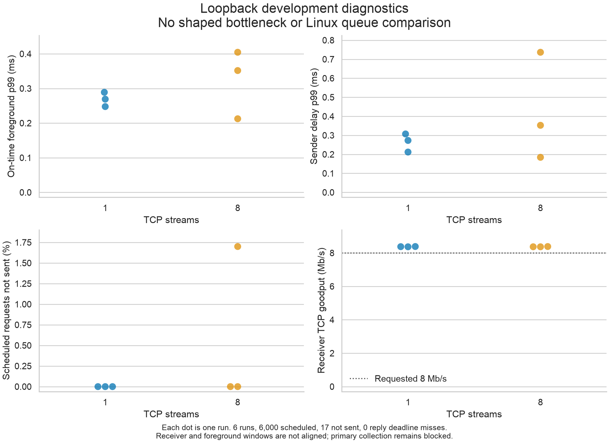

# Local diagnostic evidence and pilot readiness

Decision on October 27, 2026: do not begin primary collection. The local workflow
runs, but calibrated queue behavior on the experiment host, aligned receiver
windows, and an accepted protocol are still missing.

## What ran

Six consecutive two-second loopback diagnostics alternated one and eight TCP
streams, with three runs of each. Every run requested 8 Mb/s aggregate TCP load
and scheduled 1,000 foreground UDP requests at 500 requests/s. Requests and
replies were 512 bytes. There was no warmup, no shaped bottleneck, and no applied
Linux queue policy. All six attempts completed and passed bundle-integrity
validation. None was excluded or replaced.

Collection used source commit
913b5092445ca09134e3dd79b3f5a9d8d7b643ae with a clean working tree on macOS
(Darwin 24.5.0), Python 3.14.3, and iperf3 3.22. CPU percentages are unavailable
on this platform. Every run is marked ineligible for primary analysis.

| Run order | TCP streams | Requests not sent | On-time p99 RTT, ms | Sender-delay p99, ms | TCP receiver goodput, Mb/s |
|---|---:|---:|---:|---:|---:|
| 1 | 1 | 0 | 0.289 | 0.307 | 8.385 |
| 2 | 8 | 17 | 0.405 | 0.737 | 8.370 |
| 3 | 1 | 0 | 0.269 | 0.273 | 8.376 |
| 4 | 8 | 0 | 0.352 | 0.353 | 8.384 |
| 5 | 1 | 0 | 0.248 | 0.212 | 8.368 |
| 6 | 8 | 0 | 0.213 | 0.184 | 8.368 |

Of 6,000 scheduled requests, 5,983 were sent and answered within the deadline.
Run 2 missed 17 send slots, or 1.7% of its schedule. Those records remain in the
export. Its low RTT percentile does not erase the generator failure. The other
five runs do not establish that the generator will remain reliable for a
60-second loaded experiment.

Measured TCP goodput was about 8.37 to 8.38 Mb/s against 8 Mb/s requested. The
short receiver window and application pacing need calibration; these numbers
must not be presented as proof of exact load control. Receiver and foreground
windows overlap but are not aligned. Six short runs support a development check,
not a flow-count effect estimate or a queue-policy claim. No confidence interval
or significance claim is attached to this figure.

## Reproduce the evidence

The committed reference export contains all six run summaries, every scheduled
measurement request, and hashes. It omits absolute clocks and machine names.
The raw bundles remain under the ignored runs/loopback-pilot-20261027 directory
on the collection machine. The export is sufficient to redraw this figure; it
does not replace the raw bundles for an independent full-bundle audit.

After installing requirements-plots.txt, redraw into a new output path:

    .venv/bin/python scripts/plot_diagnostics.py data/reference/loopback-pilot --output runs/loopback-diagnostics-reproduced.png

To collect new diagnostics, use the commands in the
[operating guide](running-experiments.md), alternating --flows 1 and --flows 8
three times with --seconds 2 and a different output directory for each attempt.
Keep the same 8,000,000 bit/s aggregate request. New observations are additional
attempts and will not reproduce the exact timing values in this table.

## Evidence needed for a go decision

1. Confirm the Linux hardware, kernel and tool versions, permissions, and course
   requirements. Review and accept the candidate protocol.
2. Repeat the privileged namespace tests on the experiment hardware. Inspect routes,
   delay placement, offloads, CUBIC, ECN, queue parameters, and cleanup.
3. Calibrate the 100 Mb/s bottleneck and confirm the configured load below
   capacity and continuously backlogged senders above capacity. Verify that
   excess and forged foreground markings cannot obtain priority.
4. Align bulk and foreground measurement windows, finish schedule execution and
   replacement-attempt tracking, and validate the final primary-run schema.
5. Measure sender overhead and timing on Linux for the full duration, retain
   all invalid attempts, freeze numerical tolerances, and record a new decision.

These are the remaining acceptance criteria in issues #2 through #11. A code
merge does not satisfy them or turn loopback measurements into Linux results.

## Separate Linux integration check

The manual [hosted Linux check](https://github.com/srgangaram-swe/networks_project/actions/runs/40626936122)
passed at source revision 46c1953fc974d16582db6fd5592d48930ea0e724. The
linux-namespaces job ran with explicit permission on a disposable Ubuntu 24.04
runner and Python 3.12; it was not the skipped group in ordinary CI.

The test executed FIFO, FQ-CoDel, CAKE best effort, and bounded CAKE in fresh
client-router-server namespaces. For each profile, it ran real UDP/TCP traffic,
checked qdisc attachment, validated the completed bundle, required an observed
minimum reply RTT above 18 ms for the proposed 20 ms path, and verified an empty
ownership journal after teardown. The four-profile test passed in 23.832 seconds.

This establishes that the commands and lifecycle work with that runner's Linux
kernel. It does not establish equivalent effective shaping, forged-mark
resistance, independent failure recovery, or readiness for primary collection.
The Linux integration observations are separate from the six Mac loopback runs
plotted above and are not part of that reference dataset.
